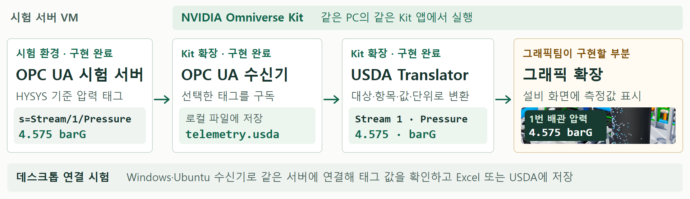

# OPC UA 수신과 Omniverse 시각화 연동

Windows·Ubuntu에서는 데스크톱 수신기로 OPC UA 서버에 연결해 태그 값을 확인하고 Excel이나 USDA로 저장할 수 있다. Omniverse에서는 Kit 수신기가 저장한 USDA를 Translator가 읽고, 그래픽팀은 그 측정값을 자기 확장의 설비 화면에 연결한다.



[태그를 화면 항목에 연결하는 전체 그림 보기](exts/hd.usda.translator/docs/graphics-handoff.png)

<a id="데스크톱-수신기-실행"></a>

## 1. 데스크톱 수신기로 OPC UA 연결 테스트

Windows 또는 Ubuntu에서 수신기를 실행해 서버에 접속하고 태그 값이 들어오는지 확인한다. 선택한 태그의 최신값은 Excel이나 USDA로 저장할 수 있다.

### Windows 데스크톱 실행

Windows x64에서 `OPCUA-Receiver.exe`를 내려받아 실행한다. [Windows 수신기 다운로드](https://github.com/ljw-8888/opcua-receiver/releases/download/v0.3.1/OPCUA-Receiver.exe)

### Ubuntu 데스크톱 실행

배포 파일을 내려받은 폴더에서 압축을 풀고 실행한다. [Ubuntu x86-64 수신기 다운로드](https://github.com/ljw-8888/opcua-receiver/releases/download/v0.3.1/OPCUA-Receiver-Ubuntu-x86_64.tar.gz)

```bash
mkdir -p opcua-receiver-app
tar -xzf OPCUA-Receiver-Ubuntu-x86_64.tar.gz -C opcua-receiver-app
cd opcua-receiver-app
./OPCUA-Receiver
```

앱 메뉴에 등록하려면 같은 폴더에서 `bash install-launcher.sh`를 실행한다.

### 태그 수신과 저장

1. **서버 연결** 탭에 Endpoint URL을 입력하고 **연결**을 누른다. 시험 서버는 `opc.tcp://218.52.73.150:4840/hd/`, 보안 정책은 `None`, 사용자 인증은 `Anonymous`다. 현장 서버에서는 담당자가 제공한 주소와 보안 설정을 사용한다.
2. **서버 항목 → Objects → Telemetry**에서 `Stream/1/Pressure`와 `Stream/1/Temperature`를 체크한다. 주소를 아는 태그는 **태그 관리**에서 Namespace URI와 NodeId로 직접 등록한 뒤 **수신할 태그 목록**에 추가해도 된다.
3. **서버 연결** 탭에서 저장 형식과 결과 파일을 고르고 **수신·저장 시작**을 누른다. 출력 경로는 기존 폴더 안의 파일명까지 지정한다. 압력·온도의 값과 단위가 표에 뜨고 **마지막 저장 성공** 시각이 바뀌면 수신과 저장이 동작한 것이다.

| 저장 형식 | 기본 저장 주기 | 저장 예 |
|---|---|---|
| Excel (`.xlsx`) | 5초 | `telemetry.xlsx`에 태그별 최신값을 기록한다. **Excel 저장값 보기**에서 마지막으로 저장한 시트를 확인할 수 있다. |
| USDA (`.usda`) | 1초 | `telemetry.usda`에 태그별 값·단위·품질·수신 시각을 기록한다. |

[Windows·Ubuntu 수신기 GUI 가이드](opcua-test/receiver-guide.md)

<a id="asyncua-rebuild"></a>
<a id="테스트와-빌드"></a>
<a id="데스크톱-소스-실행-및-빌드"></a>

<details>
<summary>데스크톱 수신기를 소스로 실행하거나 빌드할 때</summary>

저장소 전체를 복제한 뒤 `opcua-test` 폴더에서 실행한다. 공통 수신 코드와 USDA 저장 코드는 `exts` 폴더에 있다.

#### Windows · PowerShell

```powershell
py -3.12 -m venv .venv
$python = ".\.venv\Scripts\python.exe"
& $python -m pip install -r requirements-receiver.txt
& $python receiver_gui.py
```

실행한 창을 닫고 아래 명령으로 빌드한다. 릴리스에 첨부된 `asyncua` 소스를 사용할 때는 압축을 푼 폴더를 지정해 먼저 `& $python -m pip install --force-reinstall --no-deps "C:\src\asyncua-2.1.0"`를 실행한다.

```powershell
& $python -m pip install PyInstaller==6.22.3
& $python -m PyInstaller --clean --noconfirm --distpath ../dist --workpath ../build receiver.spec
```

#### Ubuntu · 터미널

```bash
python3.12 -m venv .venv
.venv/bin/python -m pip install -r requirements-receiver.txt
bash run-receiver.sh
```

실행한 창을 닫고 아래 명령으로 빌드한다. 릴리스에 첨부된 `asyncua` 소스를 사용할 때는 압축을 푼 폴더를 지정해 먼저 `.venv/bin/python -m pip install --force-reinstall --no-deps "/path/to/asyncua-2.1.0"`를 실행한다.

```bash
.venv/bin/python -m pip install PyInstaller==6.22.3
.venv/bin/python -m PyInstaller --clean --noconfirm --distpath ../dist --workpath ../build receiver.spec
tar -czf ../dist/OPCUA-Receiver-Ubuntu-x86_64.tar.gz -C ../dist OPCUA-Receiver -C ../opcua-test install-launcher.sh icons/opcua-receiver.svg
```

GitHub Actions의 **Desktop receiver build**에서도 Windows·Ubuntu 배포본을 만들 수 있다.

</details>

## 2. Omniverse에서 수신·시각화

### Omniverse Kit에서 시작하기

Kit에서 바로 수신할 때는 아래 절차부터 시작한다. 수신기 확장은 Python 3.12를 내장한 Windows·Linux x86-64용 GUI Kit 앱에서 사용할 수 있다.

수신기만 설치할 때는 [Kit 수신기 ZIP](https://github.com/ljw-8888/opcua-receiver/releases/download/v0.3.1/hd.opcua.receiver-0.3.1.zip)을 풀고 그 안의 `exts`를 등록한다. Translator까지 사용하려면 아래처럼 저장소를 복제한다.

```bash
git clone https://github.com/ljw-8888/opcua-receiver.git
```

1. Kit에서 **Window → Extensions**를 연다. 톱니바퀴를 눌러 **Extension Search Paths**를 연다.
2. **+**를 누르고 새 경로 칸을 더블클릭한다. 저장소 안의 `exts` 폴더 절대 경로를 입력하고 Enter를 누른다. 예를 들어 Windows에서는 `C:\work\opcua-receiver\exts`, Ubuntu에서는 `/home/user/opcua-receiver/exts`다. 이 폴더 바로 아래에 `hd.opcua.receiver`와 `hd.usda.translator`가 있어야 한다.
3. 확장 목록에서 `hd.opcua.receiver`를 검색해 **OPC UA Receiver**를 켠다. 검색어를 `hd.usda.translator`로 바꾸고 **Live USDA Translator**도 켠다. **Window** 메뉴에 **OPC UA Settings**와 **Live USDA Translator**가 보이면 등록이 끝났다.

Kit을 다시 열 때도 두 확장을 사용하려면 각각 **Autoload**를 켠다. 서버 연결과 파일 선택은 앱을 연 뒤 진행한다. [NVIDIA 확장 등록 화면 안내](https://docs.omniverse.nvidia.com/workflows/latest/extensions/ui_window_tutorial.html#step-2-add-the-extension-to-omniverse-code)

### Kit 수신기에서 로컬 USDA 저장

1. **Window → OPC UA Settings**를 연다. **서버 연결** 탭에 사용할 Endpoint를 입력하고 **연결**을 누른다. 시험 서버는 `opc.tcp://218.52.73.150:4840/hd/`이며, `None`과 `Anonymous`로 연결한다.
2. **Objects → Telemetry**에서 확인할 태그를 고른다. 처음 시험할 때는 `Stream/1/Pressure`와 `Stream/1/Temperature`를 선택한다.
3. **저장 형식**에서 `USD (.usda)`를 선택하고, Kit을 실행 중인 PC의 기존 폴더에 `telemetry.usda`를 지정한다. **수신·저장 시작**을 눌러 최근 저장 시각이 갱신되는지 확인한다. [Kit 수신기 가이드](exts/hd.opcua.receiver/docs/README.md)

### Translator에서 측정값 확인

같은 Kit 앱에서 **Window → Live USDA Translator**를 연다. `Open USDA...` 버튼으로 수신기가 쓰고 있는 파일을 고르면 뷰포트 배지에 `USDA: Live`와 측정값이 표시된다. **Badge tags**에서 표시할 태그를 바꿀 수 있다. `No tag`가 뜨면 선택한 태그가 수신기의 저장 목록에 있는지 확인한다.

시험 서버에 접속할 수 없을 때는 [예제 USDA](exts/hd.usda.translator/docs/examples/telemetry.usda)로 파일 읽기를 확인할 수 있다. 수신 종료 시점에 저장한 파일이므로 배지는 `Stopped`를 표시한다. **View source**에서 Stream 1의 저장된 압력 `4.575 barG`를 확인할 수 있다. [Translator 조작 가이드](exts/hd.usda.translator/docs/README.md) · [현장 태그에 맞게 파서 수정하기](exts/hd.usda.translator/docs/updating-the-parser.md)

### 시각화 확장에서 전체 측정값 받기

그래픽팀이 추가할 시각화 확장은 같은 Kit 앱에서 1초마다 `get_latest_measurements()`를 한 번 호출한다. 배지에서 고른 다섯 줄과 관계없이, 현재 USDA에 저장된 모든 태그의 최근 측정값을 받는다.

**측정값을 설비별 화면에 연결하는 예**

한 번 호출해 세 행을 받았다면, 각 행의 대상과 항목으로 화면 칸을 찾고 그 행의 값과 단위를 표시한다.

| 대상 `m.target` | 항목 `m.quantity` | 값 `m.value` | 단위 `m.unit` | 연결할 화면 칸 | 표시 결과 |
|---|---|---:|---|---|---|
| Stream 1 | Pressure | 4.575 | barG | 1번 배관 압력 | **4.575 barG** |
| Stream 1 | Temperature | 0.57 | degC | 1번 배관 온도 | **0.57 degC** |
| Stream 10 | Pressure | 5.25 | barG | 10번 배관 압력 | **5.25 barG** |

```python
import asyncio
from hd_usda_translator import get_latest_measurements

async def update_view(render_frame):
    while True:
        render_frame(get_latest_measurements())
        await asyncio.sleep(1)
```

`render_frame`은 그래픽팀의 화면 갱신 함수다. 화면을 만들 때 정한 `(target, quantity)`로 매칭하므로 다음 호출에서 행 순서가 바뀌어도 같은 배관의 칸을 갱신한다. 값이 `None`이면 해당 행의 `status`를 사용하고, 목록이 비면 화면을 수신 대기로 돌린다.

Translator의 뷰포트 오버레이도 같은 함수를 호출한다. 확장 의존성 설정과 갱신 루프를 시작하고 종료하는 예제는 연동 가이드에 있다. [시각화 연동 가이드](exts/hd.usda.translator/docs/integration.md) · [오버레이 코드](exts/hd.usda.translator/hd_usda_translator/overlay.py)

### 현장 연결 전 확인할 것

- **DCS 태그 정의** — 실제 Endpoint와 읽기 권한을 확인하고, 대표 설비 하나의 실측 태그와 HYSYS 태그를 받는다. 각 태그의 Namespace URI, NodeId, 자료형, 단위를 대조해 같은 설비의 두 값이 뒤바뀌지 않도록 매핑한다.
- **운영 PC에서의 표시** — 사용할 Kit 앱에서 수신기와 Translator를 함께 켜고, 같은 태그의 값을 수신 표와 배지에서 대조한다. 수신기의 파일 저장을 중지하면 배지가 `Stopped`로 바뀌고, 같은 USDA에 저장을 재개하면 현재값으로 돌아오는지 확인한다.

## 라이선스

수신기에 포함한 `asyncua 2.1.0`의 라이선스는 LGPL v3 이상이다. [사용 고지](licenses/asyncua-NOTICE.txt) · [LGPL v3](licenses/LGPL-3.0.txt) · [GPL v3](licenses/GPL-3.0.txt) · [글꼴 라이선스](exts/hd.opcua.receiver/data/FONT-LICENSE.txt)
