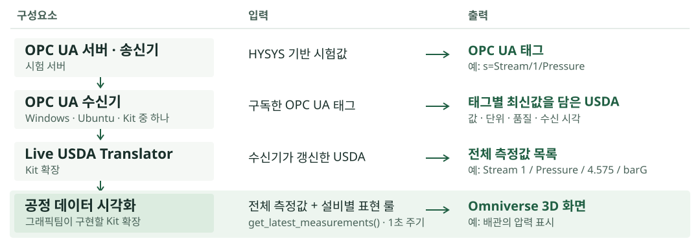

# OPC UA 수신과 Omniverse 시각화 연동

수신기가 OPC UA 서버에서 태그를 구독해 USDA 파일에 저장한다. Live USDA Translator가 이 파일을 읽으면 시각화 확장은 대상·항목·값·단위를 한 번에 받아 화면에 쓸 수 있다.



## 1. 수신기에서 태그를 골라 USDA로 저장하기

Windows, Ubuntu, Omniverse Kit 중 데이터를 수신할 환경 하나를 고른다.

### Windows 데스크톱 실행

Windows x64에서 `OPCUA-Receiver.exe`를 내려받아 실행한다. [Windows 수신기 다운로드](https://github.com/ljw-8888/opcua-receiver/releases/download/v0.3.0/OPCUA-Receiver.exe)

### Ubuntu 데스크톱 실행

배포 파일을 내려받은 폴더에서 압축을 풀고 실행한다. [Ubuntu x86-64 수신기 다운로드](https://github.com/ljw-8888/opcua-receiver/releases/download/v0.3.0/OPCUA-Receiver-Ubuntu-x86_64.tar.gz)

```bash
mkdir -p opcua-receiver-app
tar -xzf OPCUA-Receiver-Ubuntu-x86_64.tar.gz -C opcua-receiver-app
cd opcua-receiver-app
./OPCUA-Receiver
```

앱 메뉴에 등록하려면 같은 폴더에서 `bash install-launcher.sh`를 실행한다.

### Omniverse Kit에서 시작하기

Python 3.12가 내장된 Windows·Linux x86-64 GUI Kit 앱에서 사용한다. [수신기 확장 ZIP](https://github.com/ljw-8888/opcua-receiver/releases/download/v0.3.0/hd.opcua.receiver-0.3.0.zip)을 풀고 **Window → Extensions**의 검색 경로에 `exts` 폴더를 추가한다. **OPC UA Receiver**를 켜면 설정 창이 열린다.

Translator까지 사용할 때는 아래 명령으로 저장소를 받으면 두 확장이 같은 `exts` 폴더에 들어 있다.

```bash
git clone https://github.com/ljw-8888/opcua-receiver.git
```

### 태그 수신과 저장

1. **서버 연결** 탭에 Endpoint URL을 입력하고 **연결**을 누른다. 시험 서버 주소는 `opc.tcp://218.52.73.150:4840/hd/`이며 보안 정책은 `None`, 사용자 인증은 `Anonymous`다. 다른 서버는 운영자가 제공한 주소와 보안 설정을 쓴다.
2. 연결되면 **서버 항목**에서 그룹을 열어 받을 태그를 체크한다. 시험 서버에서는 **Objects → Telemetry**에서 `Stream/1/Pressure`와 `Stream/1/Temperature`를 고르면 된다. 주소를 이미 알고 있다면 **태그 관리**에서 Namespace URI와 NodeId로 직접 등록하고, 등록한 행을 **수신할 태그 목록**에 추가한다.
3. **서버 연결** 탭의 **저장 형식**에서 `USD (.usda)`를 고른다. **결과 파일**에 기존 폴더 안의 새 파일명(예: `telemetry.usda`)을 지정하고 **수신·저장 시작**을 누른다. 표에 값·단위·품질이 나오고 저장 성공 시각이 갱신되는지 확인한다.

| 저장 형식 | 기본 주기 | 용도 |
|---|---|---|
| USD (`.usda`) | 1초 | Translator에 전달할 태그별 최신값·단위·품질·시각 |
| Excel (`.xlsx`) | 5초 | 태그별 최신값을 시트에서 확인. **Excel 저장값 보기**로 마지막 저장 내용 확인 |

태그 검색, 직접 등록, 파일 선택은 각 환경의 화면을 참고한다. [Windows·Ubuntu GUI 가이드](opcua-test/receiver-guide.md) · [Kit 수신기 가이드](exts/hd.opcua.receiver/docs/README.md)

## 2. Translator에서 측정값 확인하기

1. 시각화에 사용할 Kit 앱에 **저장소의** `exts` 폴더를 등록하고 **Live USDA Translator**를 켠다. 데스크톱 수신기를 사용했어도 이 단계는 같다.
2. **Window → Live USDA Translator**를 열고 `Open USDA...` 버튼으로 1단계에서 저장 중인 파일을 고른다. 수신기와 Kit가 다른 PC라면 두 PC에서 접근할 수 있는 공유 폴더에 저장하고 Kit에서도 같은 파일을 연다.
3. 뷰포트에서 `USDA: Live`와 선택한 배관의 값을 확인한다. **Badge tags**에서 표시할 태그를 바꿀 수 있다. `No tag`가 뜨면 수신기에 저장하도록 선택한 태그와 배지에서 고른 태그가 같은지 확인한다.

시험 서버에 접속할 수 없을 때는 [예제 USDA](exts/hd.usda.translator/docs/examples/telemetry.usda)로 파일 읽기를 확인할 수 있다. 수신 종료 시점에 저장한 파일이므로 배지는 `Stopped`를 표시한다. **View source**에서 Stream 1의 저장된 압력 `4.575 barG`를 확인할 수 있다. [Translator 조작 가이드](exts/hd.usda.translator/docs/README.md) · [현장 태그에 맞게 파서 수정하기](exts/hd.usda.translator/docs/updating-the-parser.md)

## 3. 시각화 확장에서 전체 측정값 받기

같은 Kit 앱에서 실행 중인 시각화 확장은 1초마다 `get_latest_measurements()`를 한 번 호출한다. 배지에서 고른 다섯 줄과 관계없이, 현재 USDA에 저장된 모든 태그의 최근 측정값을 받는다.

```python
import asyncio
from hd_usda_translator import get_latest_measurements

async def update_view(render_frame):
    while True:
        render_frame(get_latest_measurements())
        await asyncio.sleep(1)
```

`render_frame`은 그래픽팀의 화면 갱신 함수다. 예를 들어 `target="Stream 1"`, `quantity="Pressure"`인 행의 `value`와 `unit`을 Stream 1 배관에 표시한다. 값이 `None`이면 해당 행의 `status`를 사용하고, 목록이 비면 화면을 수신 대기로 돌린다.

Translator의 뷰포트 오버레이도 같은 함수를 호출한다. 확장 의존성 설정과 갱신 루프를 시작하고 종료하는 예제는 연동 가이드에 있다. [시각화 연동 가이드](exts/hd.usda.translator/docs/integration.md) · [오버레이 코드](exts/hd.usda.translator/hd_usda_translator/overlay.py)

<a id="asyncua-rebuild"></a>
<a id="테스트와-빌드"></a>

## 데스크톱 소스 실행 및 빌드

저장소 전체를 복제한 뒤 `opcua-test` 폴더에서 실행한다. 공통 수신 코드와 USDA 저장 코드는 `exts` 폴더에 있다.

<details>
<summary>Windows · PowerShell</summary>

```powershell
py -3.12 -m venv .venv
$python = ".\.venv\Scripts\python.exe"
& $python -m pip install -r requirements-receiver.txt
& $python receiver_gui.py
```

실행한 창을 닫고 아래 명령으로 빌드한다. 릴리스에 첨부된 `asyncua` 소스를 사용할 때는 압축을 푼 폴더를 지정해 먼저 `& $python -m pip install --force-reinstall --no-deps "C:\src\asyncua-2.1.0"`를 실행한다.

```powershell
& $python -m pip install PyInstaller==6.22.3
& $python -m PyInstaller --clean --noconfirm --distpath ../dist --workpath ../build receiver.spec
```

</details>

<details>
<summary>Ubuntu · 터미널</summary>

```bash
python3.12 -m venv .venv
.venv/bin/python -m pip install -r requirements-receiver.txt
bash run-receiver.sh
```

실행한 창을 닫고 아래 명령으로 빌드한다. 릴리스에 첨부된 `asyncua` 소스를 사용할 때는 압축을 푼 폴더를 지정해 먼저 `.venv/bin/python -m pip install --force-reinstall --no-deps "/path/to/asyncua-2.1.0"`를 실행한다.

```bash
.venv/bin/python -m pip install PyInstaller==6.22.3
.venv/bin/python -m PyInstaller --clean --noconfirm --distpath ../dist --workpath ../build receiver.spec
tar -czf ../dist/OPCUA-Receiver-Ubuntu-x86_64.tar.gz -C ../dist OPCUA-Receiver -C ../opcua-test install-launcher.sh icons/opcua-receiver.svg
```

</details>

GitHub Actions의 **Desktop receiver build**에서도 Windows·Ubuntu 배포본을 만들 수 있다.

## 라이선스

수신기에 포함한 `asyncua 2.1.0`의 라이선스는 LGPL v3 이상이다. [사용 고지](licenses/asyncua-NOTICE.txt) · [LGPL v3](licenses/LGPL-3.0.txt) · [GPL v3](licenses/GPL-3.0.txt) · [글꼴 라이선스](exts/hd.opcua.receiver/data/FONT-LICENSE.txt)
