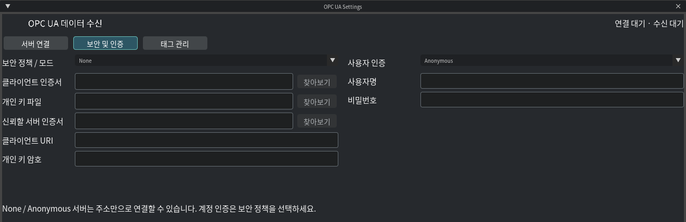
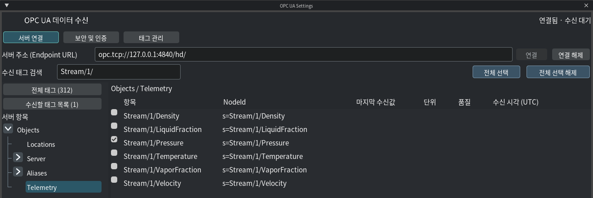
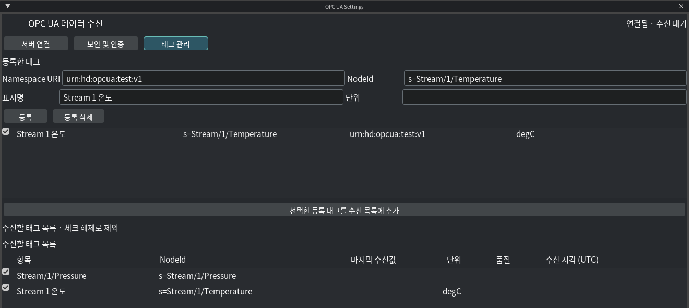
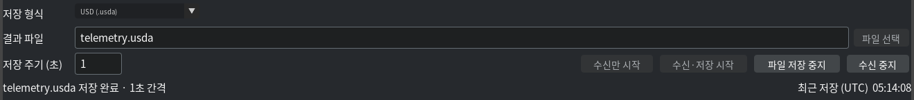

# Omniverse Kit 확장 사용 가이드

USD Composer 등 Python 3.12를 내장한 x86-64용 GUI Kit 앱에서 사용한다. 씬을 열기 전에도 서버에 연결해 값을 보거나 파일로 저장할 수 있다.

## 확장 등록

1. 배포 ZIP의 압축을 풀거나 `git clone https://github.com/ljw-8888/opcua-receiver.git`으로 저장소를 받는다.
2. **Window → Extensions**에서 검색 경로에 `exts` 폴더를 추가하고 **OPC UA Receiver**를 켠다.
3. **OPC UA Settings** 창이 열린다. 닫은 창은 **Window → OPC UA Settings**에서 다시 연다. Kit를 시작할 때마다 사용하려면 **Autoload**를 켠다.

터미널에서 실행할 때는 Kit 실행 명령 끝에 다음 옵션을 붙인다. 경로는 압축을 풀거나 저장소를 받은 위치에 맞춘다.

```text
--ext-folder "/absolute/path/to/opcua-receiver/exts" --enable hd.opcua.receiver
```

처음 켜면 필요한 Python 패키지를 Kit 캐시에 푼다. 설정 창이 영어로 열리면 **Autoload**를 켜고 Kit를 다시 시작해 한글 글꼴을 불러온다.

## 서버 연결과 태그 선택

**서버 연결** 탭에 사용할 서버의 Endpoint URL을 입력하고 **연결**을 누른다. 아래 화면은 Kit와 같은 컴퓨터에서 시험 서버를 실행한 예다. 인증서나 계정이 필요한 서버는 접속 전에 **보안 및 인증**에서 보안 정책과 인증 방식을 설정한다.



연결되면 왼쪽 **서버 항목**에서 화살표를 눌러 하위 그룹을 펼친다. 그룹 이름을 누르면 표 위에 현재 경로가 표시된다. 아래 화면에서는 **Objects → Telemetry**를 열고 `Stream/1/`을 검색한 뒤 `Stream/1/Pressure`를 체크했다.



**전체 선택**은 현재 그룹의 검색 결과를 다른 페이지까지 모두 선택한다. **전체 선택 해제**도 같은 범위에 적용된다. 서버 전체에서 찾을 때는 왼쪽의 **전체 태그**를 누른다. 이 목록에서는 태그 조회가 끝나면 **전체 선택**을 쓸 수 있다.

### 태그 주소로 추가하기

**태그 관리**에서 Namespace URI와 NodeId를 입력하고 **등록**을 누른다. 아래 온도의 주소는 `urn:hd:opcua:test:v1`, `s=Stream/1/Temperature`다. 표시명은 `Stream 1 온도`로 지정했고, 단위는 비워 두어 서버가 보낸 `degC`를 쓴다.

위쪽 등록 목록에서 온도를 체크한 뒤 **선택한 등록 태그를 수신 목록에 추가**를 누른다. 아래쪽에 압력과 온도가 함께 보인다. 이번 수신에서 빼려면 아래쪽 체크를 푼다. 위쪽 등록 정보는 서버 주소별로 보관된다.



## 실시간 수신과 파일 저장

**서버 연결** 탭의 **수신만 시작**을 누르면 파일을 지정하지 않고도 값·단위·품질·수신 시각을 볼 수 있다. 파일에도 쓰려면 **저장 형식**, **결과 파일**, **저장 주기 (초)**를 정하고 **수신·저장 시작**을 누른다.

### Excel 통합문서

**Excel (.xlsx)**을 고르고 **파일 선택**에서 통합문서를 지정한다. 기본 저장 주기는 5초다. 아래 화면에서는 압력 `4.575 barG`와 온도 `0.57 degC`를 받아 `telemetry.xlsx`에 저장했다. 각 행의 **수신 시각 (UTC)**은 태그 값을 받은 시각이고, 오른쪽 아래 **최근 저장 (UTC)**은 파일을 갱신한 시각이다.


**Excel 저장값 보기**를 누르면 마지막으로 저장한 시트를 확인할 수 있다. 태그별 값은 `최신값` 시트에, HYSYS 항목과 연결된 값은 `HYSYS` 시트에도 기록된다.

### USDA 데이터 파일

**USD (.usda)**를 고르고 **파일 선택**에서 수신 데이터용 파일을 지정한다. 새 파일을 만들거나 같은 서버의 수신 데이터를 담은 USDA를 다시 사용할 수 있다. **수신·저장 시작**을 누르면 기본 1초마다 태그별 최신값을 기록한다. 설비 모델이 들어 있는 원본 USD는 그대로 두고, 다른 Kit 앱에서 이 데이터 파일을 열어 값을 읽는다.



Excel과 USDA 사이를 바꿀 때는 **파일 저장 중지**를 누르고 형식과 파일을 다시 고른다. 화면의 수신은 계속된다. 태그를 바꾸려면 **수신 중지**, 서버 접속까지 끝내려면 **연결 해제**를 누른다. 설정 창만 닫으면 수신은 계속된다.

## USDA 데이터 형식

한 파일에는 OPC UA 서버 한 곳의 데이터를 담는다. 형식 식별자는 `customLayerData["opcuaFormat"]`의 `hd.opcua.receiver/telemetry/1`이다. `/Telemetry` 아래에는 연결 정보가 있고, `/Telemetry/Tags` 아래에는 구독한 태그마다 Prim이 하나씩 있다.

| Prim | Custom attribute | 의미 |
|---|---|---|
| `/Telemetry` | `opcua:source`, `opcua:connection` | Endpoint URL과 현재 연결 상태(`Connected`, `Reconnecting`, `Connecting`, `Disconnected`) |
| `/Telemetry` | `opcua:publishing`, `opcua:publishedAt` | 저장 중 여부와 파일을 마지막으로 갱신한 시각(UTC) |
| `/Telemetry/Tags`의 자식 하나 | `opcua:namespaceUri`, `opcua:identifier`, `opcua:displayName` | Namespace URI, 인덱스를 제외한 NodeId(예: `s=Stream/1/Pressure`), 표시명 |
| 같은 태그 | `opcua:dataType`, `opcua:valueType`, `opcua:value`, `opcua:unit` | 서버가 선언한 OPC UA 자료형, 수신한 Variant 자료형, 값, 표시 단위. 수동 단위 설정이 있으면 그 단위를 쓴다. |
| 같은 태그 | `opcua:quality`, `opcua:sampleState` | OPC UA 품질명 및 이 값을 현재값으로 쓸 수 있는지 나타내는 상태 |
| 같은 태그 | `opcua:sourceTimestamp`, `opcua:receivedAt` | 서버가 제공한 측정 시각과 수신기가 실제로 받은 시각(ISO 8601 UTC). 제공되지 않은 시각은 빈 문자열이다. |

태그는 `(source, namespaceUri, identifier)`로 식별한다. Prim 이름에는 NodeId에서 따온 이름과 이 세 항목의 해시가 들어간다. 표시명을 바꾸거나 재연결로 Namespace 인덱스가 바뀌어도 경로는 같다. 다시 저장을 시작하면 현재 선택한 태그만 파일에 남는다.

숫자·불리언·문자열과 그 1차원 배열은 USD 자료형으로 기록한다. 예를 들어 압력은 `double`, UInt64 카운터는 `uint64`다. DateTime 스칼라는 ISO 8601 문자열이다. 구조체·다차원 배열 등은 `opcua:encoding = "UaBinaryVariantBase64"`와 함께 OPC UA Binary Variant를 Base64 문자열로 기록한다. 샘플이 없거나 품질 문제로 값이 없으면 `opcua:value` 속성을 생략한다.

| `opcua:sampleState` | 의미 |
|---|---|
| `Waiting` | 첫 샘플을 기다리는 중 |
| `Current` | 현재 연결에서 받은 유효값 |
| `Stale` | 연결이 끊겼거나 저장을 중지하기 전에 받은 값. 마지막 단위와 수신 시각도 유지한다. |
| `Unavailable` | 구독 오류 등으로 사용할 수 있는 값이 없음 |

값이 일정하면 태그의 `receivedAt`은 그대로여도 파일의 `publishedAt`은 저장 주기마다 바뀐다. 수신기가 비정상 종료됐는지 판단할 때는 `publishedAt`을 확인한다.

다른 Kit에서 아래와 같이 데이터 파일을 연다. 이후 파일 변경을 확인한 시점에 `layer.Reload()`를 호출하고 필요한 태그를 다시 읽는다.

```python
from pxr import Usd

stage = Usd.Stage.Open("/shared/telemetry.usda")
layer = stage.GetRootLayer()
root = stage.GetPrimAtPath("/Telemetry")
for tag in root.GetChild("Tags").GetChildren():
    if tag.GetAttribute("opcua:sampleState").Get() == "Current":
        print(tag.GetAttribute("opcua:identifier").Get(),
              tag.GetAttribute("opcua:value").Get(),
              tag.GetAttribute("opcua:unit").Get())
```

## 기본 GUI 버튼 및 3D 표시와 연결

설정 버튼을 넣을 확장의 의존성에 `hd.opcua.receiver`를 추가한다. 버튼을 누르면 `show_settings()`가 수신기 창을 연다.

```python
import omni.ui as ui
from hd_opcua_receiver import show_settings, get_latest_samples

ui.Button("OPC UA Settings", clicked_fn=show_settings)

# Kit 메인 스레드에서 현재 구독값을 읽는다.
for row in get_latest_samples():
    tag = row["source"], row["namespace_uri"], row["identifier"]
    value, unit, quality = row["value"], row["unit"], row["quality"]
```

연결이 끊기거나 수신을 중지하면 `get_latest_samples()`는 빈 목록을 반환한다. 태그와 USD 프림은 이 API를 호출하는 앱에서 연결한다.

## 패키지 유지보수

저장소 루트에서 `python3 kit-tools/package_extension.py`를 실행하면 `dist/`에 배포용 ZIP이 생긴다. ZIP에는 확장과 패키지 메타데이터, 라이선스(`licenses/`, `data/FONT-LICENSE.txt`)가 들어 있다.

Windows·Linux용 Python 패키지를 다시 묶으려면 Linux x86-64에서 Python 3.12로 같은 명령에 `--rebuild-bundles`를 붙인다. 로컬 wheel을 쓰려면 `--wheelhouse <폴더>`도 지정한다.
