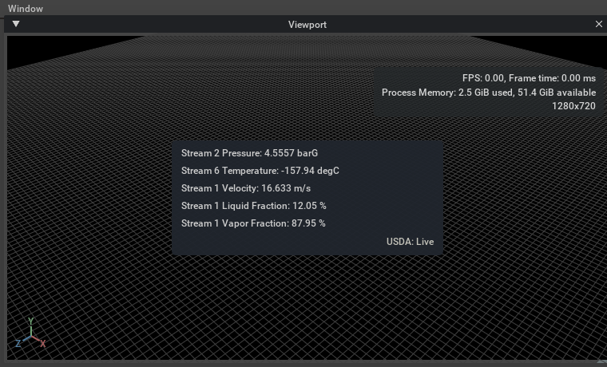
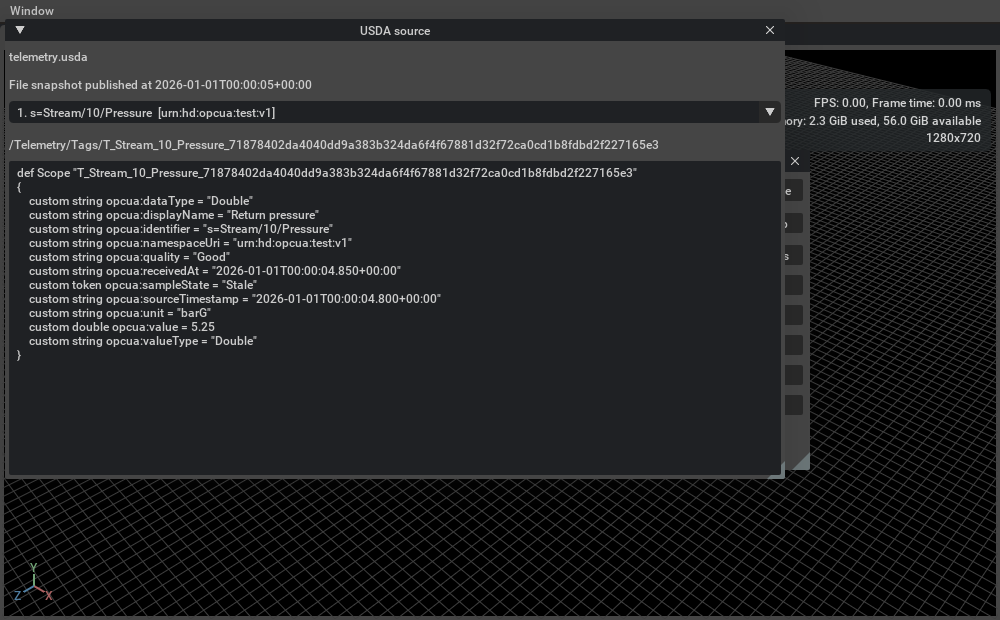

# Live USDA Translator

OPC UA 수신기가 저장한 USDA에서 태그를 골라 뷰포트 중앙에 표시하는 Kit 확장이다. 확장 ID는 `hd.usda.translator`다.

## 실행

1. Kit의 **Window → Extensions**에서 저장소의 `exts` 폴더를 검색 경로에 추가하고 **Live USDA Translator**를 켠다.
2. **Open USDA...**에서 수신기가 저장한 파일을 연다. 빈 씬에서도 배지가 뜬다. 기본 항목은 Stream 1의 압력, 온도, 유속, 액체·기체 분율이다.
3. **Badge tags**에서 바꿀 줄을 누른다. **Find tag**에 표시명, 식별자 또는 Namespace URI를 입력하고 태그를 고른다. **Reset defaults**를 누르면 기본 다섯 항목으로 돌아간다.

분율은 각 태그에서 읽어 백분율로 표시한다. 예를 들어 액체 분율 `0.0667 fraction`은 `6.67 %`다. 마우스를 줄에 올리면 태그의 식별자와 Namespace URI를 확인할 수 있다.

**Stop**은 파일 감시와 배지 표시를 중지한다. 경로를 직접 입력하거나 중지 후 다시 읽을 때는 **Show badge**를 누른다. 창을 닫았으면 **Window → Live USDA Translator**로 다시 연다.

## 파일에 저장된 값 확인

**View source**에서 배지의 줄 번호를 고르면 실제 USDA의 Prim 경로와 속성이 보인다. **Whole file**을 고르면 버튼을 누른 시점의 파일 전체가 보인다. 배지가 갱신된 후의 원문은 **View source**를 다시 눌러 확인한다.

[예제 파일](examples/telemetry.usda)을 열고 첫 줄에서 `s=Stream/10/Pressure`를 고르면 원문에 `5.25 barG`가 저장돼 있다. 이 파일은 수신이 끝난 기록이므로 배지에는 `Stream 10 Pressure: Stopped`가 뜬다.

## 배지 상태

| 표시 | 뜻 |
|---|---|
| `Live` | 수신기가 연결돼 있고 파일이 갱신 중이다. 개별 태그의 품질은 각 줄에 표시한다. |
| `No tag` | 선택한 태그가 파일에 없다. 수신기의 저장 대상에 포함됐는지 확인한다. |
| `Waiting` · `Stale` · `Unavailable` | 첫 값을 기다리거나, 이전 값이거나, 사용할 수 없는 값이다. 품질이 나쁘면 품질명이 표시된다. |
| `Reconnecting` · `Stopped` | 수신기가 재연결 중이거나 파일 저장을 끝냈다. |
| `No update` | 마지막 발행 후 **No update after (s)**에 지정한 시간이 지났다. 기본값은 10초다. |
| `File unavailable` | 파일을 읽을 수 없다. 확장 창에서 오류 내용을 확인할 수 있다. |

[측정값을 읽는 코드](integration.md) · [현장 태그에 맞게 파서 수정하기](updating-the-parser.md)
