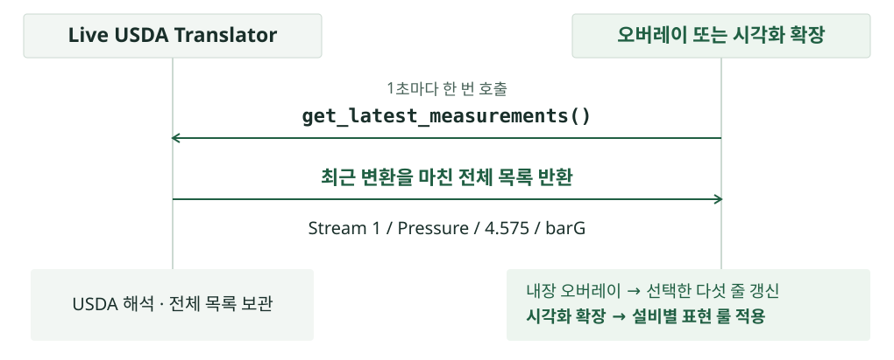

# 시각화 Extension에서 측정값 받기

Translator가 수신기의 USDA를 읽어 전체 태그를 변환해 둔다. 같은 Kit 앱에서 `get_latest_measurements()`를 호출하면 메모리에 있는 최근 한 회분을 바로 받는다.



## 오버레이로 확인하기

1. **Window → Live USDA Translator**를 열고 `Open USDA...` 버튼으로 수신기가 갱신하는 파일을 고른다. 뷰포트에 다섯 줄짜리 배지가 뜬다.
2. **Badge tags**에서 첫 줄을 누르고 압력 태그를 고른다. 시험 서버의 `s=Stream/1/Pressure`가 `4.575 barG`이면 첫 줄에 **Stream 1 Pressure: 4.575 barG**가 뜬다.
3. 다른 줄에 온도를 고르면 두 값을 함께 볼 수 있다. 배지에서 어떤 줄을 바꿔도 시각화 확장이 받는 목록에는 파일의 모든 태그가 들어 있다.

실제 화면 갱신 코드는 [overlay.py의 `ScreenBadge.refresh()`](../hd_usda_translator/overlay.py)에 있다. 한 번 호출해 받은 목록에서 `(namespace_uri, identifier)`로 사용자가 고른 태그를 찾고, 값·단위 또는 상태를 해당 줄에 쓴다. 숫자로 보려면 수신기가 저장 중인 파일을 연다. 함께 제공한 예제 파일은 수신을 종료한 시점이어서 **Stopped**가 뜬다. [배지 화면과 조작 방법](README.md)

## 다른 Kit 확장에서 사용

1. 두 확장을 같은 Kit 앱에 등록한다. 시각화 확장의 `extension.toml`에 아래 의존성을 추가한다.
2. Translator에서 수신기가 갱신하는 USDA를 열고, 배지에 값이 표시되는지 확인한다.
3. 시각화 확장의 갱신 루프에서 `get_latest_measurements()`를 한 번 호출한다.

```toml
[dependencies]
"hd.usda.translator" = { version = "0.2.0" }
```

다음은 그래픽팀 화면에 이미 만들어 둔 설비별 라벨을 갱신하는 예다. `labels`에는 `("Stream 1", "Pressure")`처럼 대상과 항목을 키로, 해당 위치의 라벨을 값으로 넣는다.

```python
import asyncio
from hd_usda_translator import get_latest_measurements


async def update_labels(labels, key_for=lambda m: (m.target, m.quantity)):
    while True:
        texts = {}
        for m in get_latest_measurements():
            key = key_for(m)
            if key in texts:
                texts[key] = "태그 중복"
            else:
                texts[key] = m.status if m.value is None else f"{m.value} {m.unit}".strip()
        for key, label in labels.items():
            label.text = texts.get(key, "수신 대기")
        await asyncio.sleep(1)
```

확장의 `on_startup()`에서 라벨을 만든 뒤 `self.task = asyncio.ensure_future(update_labels(labels))`로 시작한다. `on_shutdown()`에서는 `self.task.cancel()`로 끝낸다.

실측과 시뮬레이션이 모두 `Stream 1 / Pressure`로 들어오면 예제는 해당 자리에 **태그 중복**을 표시한다. 어느 태그가 실측인지 현장 정의서에서 확인한 뒤, 두 라벨을 각각 `(namespace_uri, identifier)`로 등록하고 `update_labels(labels, key_for=lambda m: (m.namespace_uri, m.identifier))`로 호출한다.

## 반환값

정상 수신 중인 한 행의 예는 `Stream 1 / Pressure / 4.575 / barG`다. `target`은 대상, `quantity`는 측정 항목, `value`는 값, `unit`은 단위다. `status`, `quality`, `received_at`도 함께 읽을 수 있다.

| 상황 | 시각화 확장에서 받는 값 |
|---|---|
| 정상 수신 | 읽기 전용 튜플에 태그마다 `Measurement` 한 건이 들어 있다. 숫자 `0`도 유효한 값이다. |
| 다음 갱신 전 | 같은 한 회분을 다시 받는다. 반환 순서에 의존하지 말고 대상과 항목으로 매칭한다. |
| 수신기가 저장 종료 / 연결 끊김 / 품질 이상 | 해당 행의 `value`는 `None`이며 `status`로 이유를 확인한다. 파일의 발행 시각이 제한 시간을 넘으면 `No update`다. |
| 파일 선택 전 / 경로 변경 직후 / 읽기 실패 / Translator에서 **Stop** | 빈 튜플 `()`을 받는다. 이전 값을 화면에서 현재값으로 유지하지 않는다. |

한 회분에는 파일에 담긴 태그별 최신값이 들어 있다. 각 태그의 실제 수신 시각은 다를 수 있다. 현장 태그를 어느 설비에 연결할지는 실제 태그 정의를 확인한 뒤 정한다. [현장 태그 적용 가이드](updating-the-parser.md)

## 저장된 샘플 확인

Kit에서 확장을 켜고 **Window → Script Editor**에서 실행하면 함께 제공한 예제 파일을 읽을 수 있다.

```python
from pathlib import Path
import hd_usda_translator
from hd_usda_translator.telemetry import read_snapshot

extension_dir = Path(hd_usda_translator.__file__).resolve().parents[1]
path = extension_dir / "docs/examples/telemetry.usda"
snapshot = read_snapshot(path)

key = (snapshot.source, "urn:hd:opcua:test:v1", "s=Stream/1/Pressure")
sample = snapshot.tags[key]
print(sample.value, sample.unit, sample.quality, sample.state)
```

결과는 `4.575 barG Good Stale`다. `Good`은 마지막 수신 당시의 품질이고 `Stale`은 그 값이 더 이상 현재값이 아니라는 뜻이다.

`read_snapshot()`은 `Sdf.Layer.OpenAsAnonymous()`로 USDA를 열고 레이어의 `opcuaFormat`을 확인한다. `/Telemetry`에서 Endpoint와 연결·발행 상태를 읽은 뒤, `/Telemetry/Tags`의 자식 Prim을 `(Endpoint, Namespace URI, 식별자)`로 찾아볼 수 있게 한다. 각 샘플에는 값·단위 외에 표시명, 자료형, 측정 시각과 수신 시각도 들어 있다. 파일을 읽는 코드는 [telemetry.py](../hd_usda_translator/telemetry.py)에 있다.
