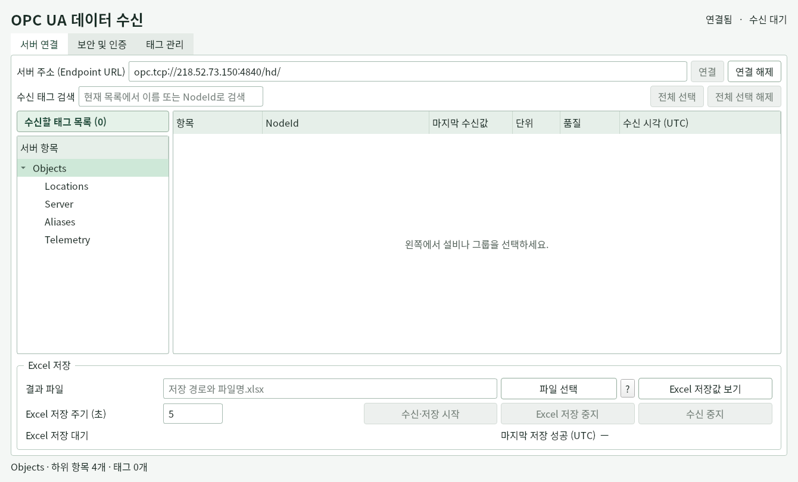
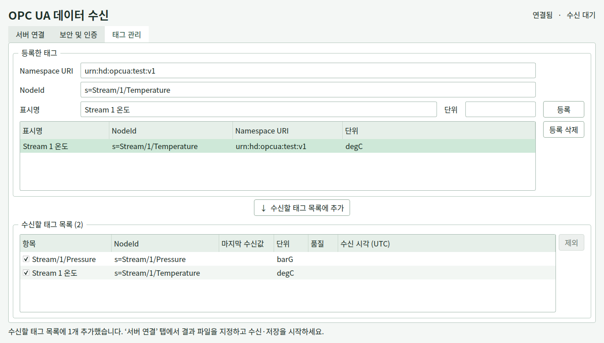
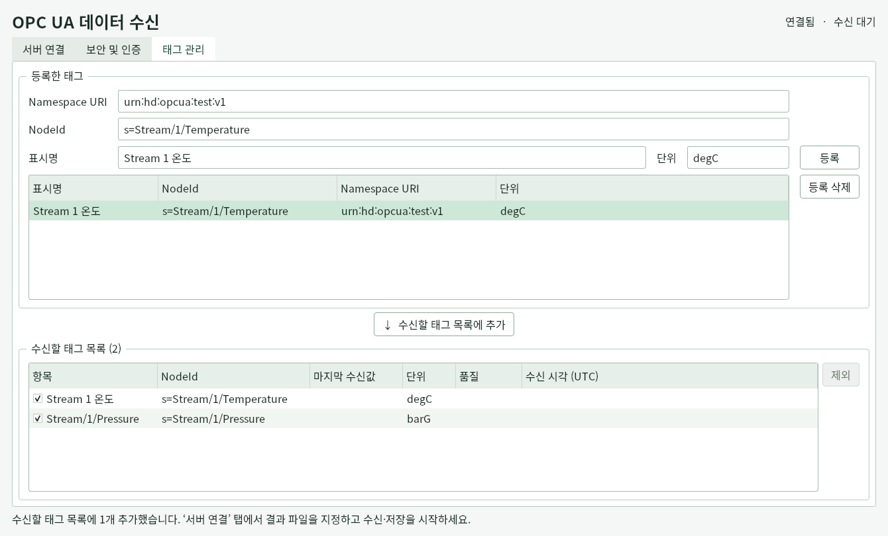
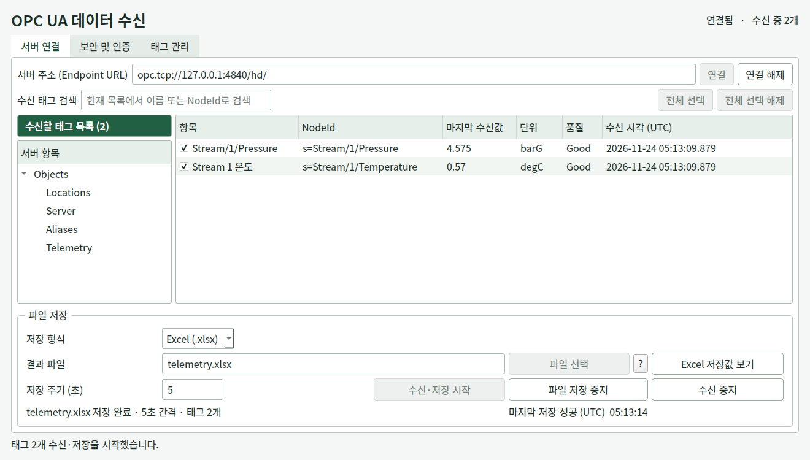

# OPC UA 수신기 GUI 가이드

**시험 서버 주소**　`opc.tcp://218.52.73.150:4840/hd/`

Windows x64와 Ubuntu x86_64에서 같은 화면을 사용한다. 실행 파일과 OS별 실행 방법은 [README](../README.md)에 있다. 아래 캡처는 시험 서버에 접속해 **목록에서 압력을 고르고, 주소를 직접 입력해 온도를 추가한 후, 두 태그를 함께 받은 화면**이다. 한 가지 방법만 써도 된다.

## 1. Endpoint로 서버에 연결

**서버 연결** 탭의 **서버 주소 (Endpoint URL)**에 위 주소를 경로 `/hd/`까지 붙여 넣고 **연결**을 누른다. 시험 서버는 `None / Anonymous`를 허용하므로 기본 설정에서는 Endpoint 하나만 입력하면 된다.

오른쪽 위에 **연결됨 · 수신 대기**가 뜨고, 왼쪽 **서버 항목**에 `Objects` 아래 그룹이 나타난다. 이때 **수신할 태그 목록 (0)**은 정상이다. 서버 접속은 끝났고, 이제 어떤 변수를 받을지 고를 수 있다.

보안 정책이나 사용자 인증을 확인하려면

**보안 및 인증** 탭의 왼쪽이 보안 정책, 오른쪽이 사용자 인증이다. 아래는 시험 서버 설정이다. 다른 서버가 계정이나 인증서를 요구하면 그 서버 담당자가 지정한 모드·인증 방식에 맞춰 입력한다. 인증서·개인 키는 **찾아보기**로 파일을 고른다. 설정을 바꿀 때는 연결을 해제한 뒤 다시 연결한다.

## 2A. 서버에서 조회한 태그를 체크하는 방법

1. **서버 연결** 탭 왼쪽에서 **Objects → Telemetry**를 누른다. 오른쪽 표에 해당 그룹에서 조회한 태그가 나타난다. 다른 서버에서는 그 서버의 설비·그룹 이름을 고른다.
2. **수신 태그 검색**에 태그 이름이나 NodeId의 일부를 입력한다. 선택한 그룹 안에서 일치하는 행만 남는다. 아래 예시는 `Stream/1/`로 찾은 뒤 `Stream/1/Pressure` 행 왼쪽의 **체크박스**를 누른 화면이다. 왼쪽 버튼이 **수신할 태그 목록 (1)**로 바뀐다.
3. 이 방법에서는 서버가 제공한 태그 주소를 수신기가 사용한다. 사용자가 Namespace URI나 NodeId를 입력할 필요가 없다. 압력만 받으려면 바로 **4. 수신·저장 시작**으로 진행한다.

**검색 결과가 비어 있으면** 왼쪽에서 어떤 목록을 열었는지 확인한다. `Aliases`에서 압력을 검색했다면 **Telemetry**를 누른다. **수신할 태그 목록**을 열고 검색하면 이미 선택한 태그 안에서 찾는다. 검색칸의 **×**를 누르면 현재 목록의 모든 행이 다시 보인다.

**전체 선택 / 전체 선택 해제**는 현재 표에 표시된 행에 적용된다. 조회한 태그의 Namespace URI는 **NodeId** 열의 값 위에 마우스를 올리면 볼 수 있다.

## 2B. Namespace URI와 NodeId를 직접 입력하는 방법

서버에 연결한 상태에서 **태그 관리** 탭을 연다. 서버에 존재하고 사용자에게 읽기 권한이 있는 변수라면, 앞에서 해당 그룹을 열거나 그 변수를 체크하지 않았어도 주소로 등록할 수 있다.

| 입력칸 | Stream 1 온도 예시 | 용도 |
|---|---|---|
| Namespace URI | `urn:hd:opcua:test:v1` | 태그가 속한 네임스페이스 |
| NodeId | `s=Stream/1/Temperature` | 해당 변수의 식별자. 문자열 식별자 접두사 `s=`까지 입력 |
| 표시명 | `Stream 1 온도` | 선택 사항. 비워 두면 서버의 표시명 사용 |
| 단위 | `degC` | 선택 사항. 비워 두면 서버가 제공하는 단위를 사용하며, 서버에도 없으면 빈칸 |

**① 등록** — 값을 입력하고 **등록**을 누른다. 수신기가 서버에서 변수를 확인한 뒤 위쪽 **등록한 태그**에 저장한다. 이 목록은 같은 서버에 다시 접속할 때 재사용할 수 있다.

**② 이번 수신에 추가** — 위쪽 표에서 온도 행을 선택하고 가운데 **↓ 수신할 태그 목록에 추가**를 누른다. **아래쪽 표에 온도가 나타나야** 이번 수신 대상으로 선택된 것이다. 아래 예시는 앞에서 체크한 압력까지 합쳐 두 개다. 온도만 직접 등록해 추가했다면 한 개가 보인다.

## 3. 선택한 태그 확인 및 변경

**태그 관리**의 아래쪽 표와 **서버 연결 → 수신할 태그 목록**은 같은 목록이다. 하나의 변수를 두 방법으로 골라도 한 번만 수신한다.

| 하고 싶은 일 | 조작 |
|---|---|
| 이번 수신에서만 빼기 | 아래쪽 행을 선택하고 **제외**를 누른다. 위쪽 등록 정보는 보관된다. |
| 저장해 둔 등록 정보 지우기 | 위쪽 행을 선택하고 **등록 삭제**를 누른다. 이미 이번 수신 목록에 넣은 태그까지 빼려면 아래에서도 **제외**한다. |
| 수신 중에 대상을 바꾸기 | **서버 연결 → 수신 중지**를 누른 뒤 목록을 고치고 다시 시작한다. |

## 4. 수신·저장 시작

1. **서버 연결** 탭으로 돌아와 **수신할 태그 목록**을 눌러 대상과 개수를 확인한다.
2. 아래 **Excel 저장 → 결과 파일**에 기존 폴더의 경로와 `.xlsx` 파일명을 입력하거나 **파일 선택**을 누른다. 새 이름을 지정하면 첫 수신 후 파일을 만든다. 기존 파일을 고르면 수신기 결과 시트를 갱신한다. 일반 통합문서에 동명의 시트가 있으면 별도 결과 시트를 만든다.
3. **Excel 저장 주기 (초)**를 정하고 **수신·저장 시작**을 누른다. **이 버튼을 누르는 시점부터 선택한 태그를 구독한다.**
4. 아래 화면에서 오른쪽 위는 **연결됨 · 수신 중 2개**, 두 행의 품질은 **Good**이다. 화면은 서버가 보낸 변경값을 반영하고, Excel은 설정한 주기마다 그때의 최신값을 저장한다. 하단의 **마지막 저장 성공 (UTC)**으로 파일 갱신 시각을 확인한다.

| 버튼 | 동작 |
|---|---|
| Excel 저장값 보기 | 마지막으로 저장한 내용을 수신기 미리보기에서 확인한다. Windows에 Microsoft Excel이 설치돼 있으면 별도 보기 창도 열 수 있다. |
| Excel 저장 중지 | 파일 저장만 멈춘다. 태그 수신은 계속된다. |
| 수신 중지 | 태그 구독과 파일 저장을 멈추고 서버 연결은 유지한다. 표에는 마지막 수신값이 남는다. |
| 연결 해제 | 수신과 저장을 종료하고 서버 접속을 끊는다. |

**화면은 바뀌는데 Excel이 그대로일 때**는 저장 주기와 마지막 저장 성공 시각을 확인한다. Windows에서 결과 파일을 Excel로 직접 열어 두어 잠겼다면 닫는다. 수신기는 다음 주기에 다시 저장한다.
