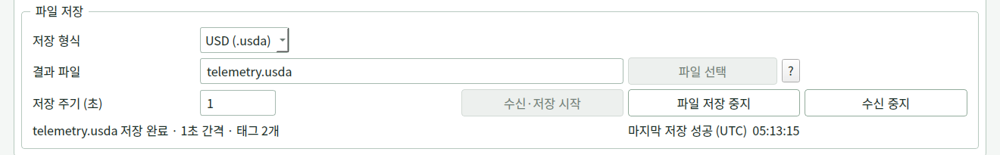

# Windows·Ubuntu 수신기 GUI 가이드

Windows와 Ubuntu의 조작 방법은 같다. 아래 화면은 Ubuntu에서 시험 서버의 Stream 1 압력과 온도를 수신한 예다. [수신기 다운로드 및 실행](../README.md)

## 1. 서버에 연결하고 태그 고르기

1. **서버 연결** 탭의 서버 주소(Endpoint URL)에 `opc.tcp://218.52.73.150:4840/hd/`를 입력하고 **연결**을 누른다. 캡처의 `127.0.0.1`은 화면 촬영 당시 같은 PC에서 띄운 서버 주소다. 현장에서는 운영자가 준 Endpoint를 입력한다.
2. 오른쪽 위에 **연결됨 · 수신 대기**가 뜨면 **서버 항목**에서 설비나 그룹을 누른다. 예시의 압력은 **Objects → Telemetry**에 있다.
3. **수신 태그 검색**에 `Stream/1/`을 입력하고 `Stream/1/Pressure`를 체크한다. 왼쪽의 `수신할 태그 목록 (1)`을 누르면 선택한 압력만 보인다.

**전체 선택**과 **전체 선택 해제**는 현재 그룹의 검색 결과에 적용된다. 다른 그룹의 태그를 찾으려면 먼저 왼쪽에서 그룹을 바꾼다. 검색어를 지우면 그 그룹의 태그가 다시 보인다.

인증서나 계정이 필요한 서버에 연결할 때

연결하기 전에 **보안 및 인증** 탭에서 서버의 보안 정책과 사용자 인증 방식을 선택한다. 인증서와 개인 키는 **찾아보기**로 고른다. 이미 연결했다면 **연결 해제** 후 설정을 바꾼다. 아래 시험 서버는 기본값인 `None`과 `Anonymous`를 허용한다.

## 2. 주소를 아는 태그 직접 추가하기

목록에서 필요한 태그를 모두 골랐다면 바로 저장을 시작해도 된다. 온도를 주소로 추가하려면 **태그 관리** 탭을 연다.

| 입력칸 | 예시 |
|---|---|
| Namespace URI | `urn:hd:opcua:test:v1` |
| NodeId | `s=Stream/1/Temperature` |
| 표시명 (선택) | `Stream 1 온도`. 비워 두면 서버에서 조회한 이름을 쓴다. |
| 단위 (선택) | 비워 두면 서버에서 조회한 단위를 쓴다. 시험 온도 태그의 단위는 `degC`다. 직접 적은 단위는 표시와 저장에 쓰이며 숫자 환산은 하지 않는다. |

**등록**을 누르고 위쪽 **등록한 태그**에서 온도 행을 선택한다. **↓ 수신할 태그 목록에 추가**를 누르면 아래쪽에 압력과 온도가 함께 나타난다. 등록한 주소는 같은 서버에 다시 접속할 때도 쓸 수 있다.

이번 수신에서만 뺄 때는 아래쪽 행을 선택하고 **제외**를 누른다. **등록 삭제**는 위쪽에 보관한 등록 정보를 지운다.

## 3. Excel로 저장하기

**서버 연결 → 수신할 태그 목록**에서 대상을 확인한다. 아래 **파일 저장**에서 `Excel (.xlsx)`을 고르고 **파일 선택**으로 결과 파일을 지정한다. `저장 주기 (초)`의 기본값은 `5`다. **수신·저장 시작**을 누른다.

표에는 마지막 수신값과 실제 수신 시각이 표시된다. 아래 `마지막 저장 성공 (UTC)`은 파일에 쓴 시각이다. 원본을 Excel에서 열어 두면 파일 잠금 때문에 저장이 지연될 수 있다. **Excel 저장값 보기**로 수신기 안에서 마지막 저장 내용을 확인할 수 있다. Windows에 Excel이 설치돼 있으면 미리보기에서 **Microsoft Excel 창으로 보기**를 눌러 별도의 보기용 창을 열 수 있다.

## 4. USDA로 저장하기

처음부터 USDA로 저장하려면 **저장 형식**에서 `USD (.usda)`를 고른다. Excel 저장 중이라면 먼저 **파일 저장 중지**를 누른다. 이때 화면에는 값이 계속 들어온다.

**파일 선택**에서 `telemetry.usda`처럼 수신 데이터용 파일을 지정하고 **수신·저장 시작**을 누른다. 기본 저장 주기는 `1`초다. 새 파일을 만들거나, 같은 서버에 대해 수신기가 만든 USDA를 다시 쓸 수 있다.

이 파일을 Kit의 **Live USDA Translator**에서 열면 배지로 압력과 온도를 확인할 수 있다. Kit가 다른 PC에 있으면 두 PC에서 접근할 수 있는 폴더를 사용한다. [Translator에서 파일 열기](../exts/hd.usda.translator/docs/README.md#실행) · [USDA 데이터 형식](../exts/hd.opcua.receiver/docs/README.md#usda-데이터-형식)

태그를 바꿀 때는 **수신 중지**를 누른 뒤 목록을 고친다. 표에는 마지막 값이 남고 서버 연결은 유지된다. 작업을 마치고 접속을 끊으려면 **연결 해제**를 누른다.
